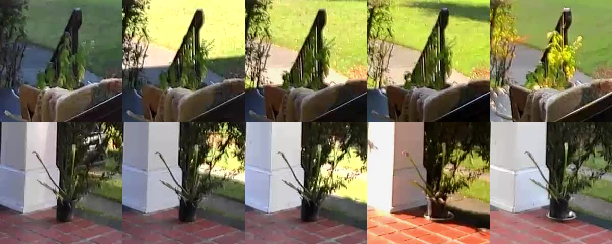

# plantlapse

Per-plant timelapses from any RTSP camera, with no setup per plant.

Point it at a camera that sees your plants. Every 15 minutes it takes a frame, finds every plant in it,
works out which plant is which by how it looks, and saves a steady square close-up of each one. Bring in a third
plant and it gets its own timelapse within the hour. Move one, swap two, or let the wind knock a pot over, and
each timelapse follows its own plant.



[A carnivorous plant over two days (8 s)](docs/demo/carnivorous-plant-timelapse.mp4)

## How it decides which plant is which

- **Finding plants:** [OWLv2](https://huggingface.co/google/owlv2-base-patch16-ensemble), open-vocabulary
  detection. Queries are "a potted plant", "a plant in a pot", and so on, with negatives ("a bush", "a hedge",
  "a lawn") so garden shrubs don't count. It runs on tiles plus a close-up around each known plant, in one batch.
- **Telling them apart:** [DINOv2](https://huggingface.co/facebook/dinov2-small) appearance embeddings, matched
  to known plants with a Hungarian assignment over appearance, position and size.
- **New plants:** something that scores as a plant three captures in a row gets its own identity.
- **Scenery:** if the same spot looked the same a day earlier, the thing was already there (a shrub, a planter
  that never moves). It is tracked but hidden, so it never shows up as a "new plant".
- **Moves and swaps:** a plant that is still where it was can't be taken by a look-alike elsewhere. Two plants
  never share a box, so a swap resolves to the right plants.
- **Steady framing:** each plant's crop size follows the upper quartile of its last two days of boxes and eases
  by at most 1% per capture, so a detector that boxes only the pot every late afternoon, or a box that reaches
  into the hedge, can't zoom the timelapse. Moving the plant resets it.
- **Night:** day and night come from the sun's elevation at your location, not the picture. A camera under a
  porch light shoots in colour all night, and lamplight changes how plants look. At night, frames are saved at
  each plant's last daylight framing and identities never change.

Every rule above has a unit test that fails without it (`tests/`).

## Run it

```bash
cp .env.example .env    # set PLANTLAPSE_STREAM_URL and PLANTLAPSE_TOKEN at least
docker compose up -d --build
curl -s localhost:5056/health
```

It runs on CPU. One daylight capture takes about 15–25 s on 4 cores. Night captures skip the models.
Compose caps it at 4 cores and 4 GB.

| Variable | Default | |
|---|---|---|
| `PLANTLAPSE_STREAM_URL` | — | RTSP (or any ffmpeg input) of the camera. Credentials in the URL are redacted from errors |
| `PLANTLAPSE_SNAPSHOT_URL` | — | optional: the camera's own JPEG snapshot URL, tried first. A camera JPEG keeps leaf detail that a low-bitrate stream keyframe smears. Token-like query values are redacted from errors |
| `PLANTLAPSE_TOKEN` | — | bearer token for every route except `/health` |
| `PLANTLAPSE_CAMERA` | `cam` | name used in storage paths |
| `PLANTLAPSE_LATLON` | — | `"lat,lon"` of the camera. Without it, night is guessed from colour saturation |
| `PLANTLAPSE_INTERVAL_MIN` | `15` | minutes between captures |
| `PLANTLAPSE_BURST` | `3` | keyframes grabbed per capture. The sharpest one is kept (wind blurs leaves) |
| `PLANTLAPSE_CROP_PX` | `768` | side of each plant's saved close-up |
| `PLANTLAPSE_TORCH_THREADS` | `4` | CPU threads for the models |
| `PLANTLAPSE_FRAMES` / `PLANTLAPSE_STATE` / `PLANTLAPSE_HF_CACHE` | | host directories for frames, the SQLite database (keep it on local disk) and model weights |

Storage is about 25 MB a day of raw frames plus about 10 MB a day per plant.

## API

| Route | |
|---|---|
| `GET /health` | public. Liveness and last capture time, no error text |
| `GET /status` | last error in full (redacted) |
| `GET /plants` · `GET /plants/{id}` | plants, with a thumbnail of the newest daylight frame the plant was found in |
| `PATCH /plants/{id}` | `{"name": ..., "hidden": ...}` |
| `POST /plants/{id}/merge` | `{"into": "<id>"}`, for when two identities are one plant |
| `GET /plants/{id}/frames` · `/frames/{stamp}.jpg` | the per-plant close-ups. `located:false` means it wasn't found in that capture |
| `GET /plants/{id}/timelapse.mp4?range=day\|week\|month\|all` | H.264, rendered on demand and cached. The frame rate adapts so short histories still give a clip worth watching |
| `GET /captures/latest.jpg` | the newest whole frame with each plant boxed and named |

## Tools

- `python -m plantlapse.tick process --reset --since <stamp>` rebuilds identities from stored frames.
  Leave a day of frames before `--since` so scenery can be recognised.
- `python -m plantlapse.backfill --recordings <dir> --camera <name> --out <frames dir>` fills past slots
  from [Frigate](https://frigate.video) recordings, if you have them.
- `python -m plantlapse.tick reframe` re-cuts every plant's crops under the current framing rules, keeping identities.
- `python -m plantlapse.sheet <out dir>` writes a contact sheet per plant, to check identities by eye.

## License

Apache-2.0. The models are Apache-2.0 too (OWLv2, DINOv2).
